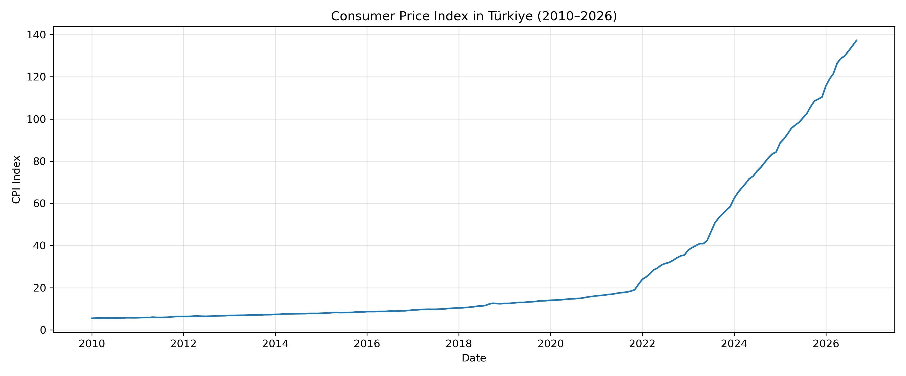
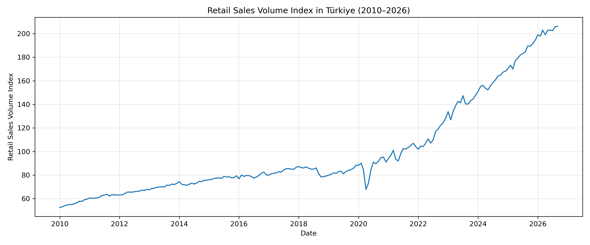
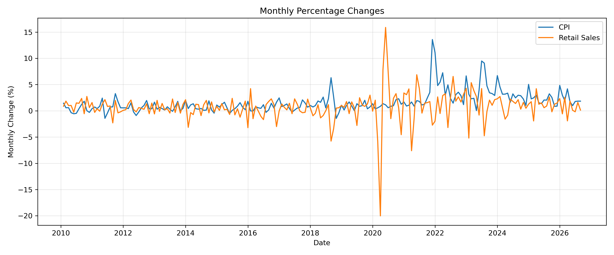
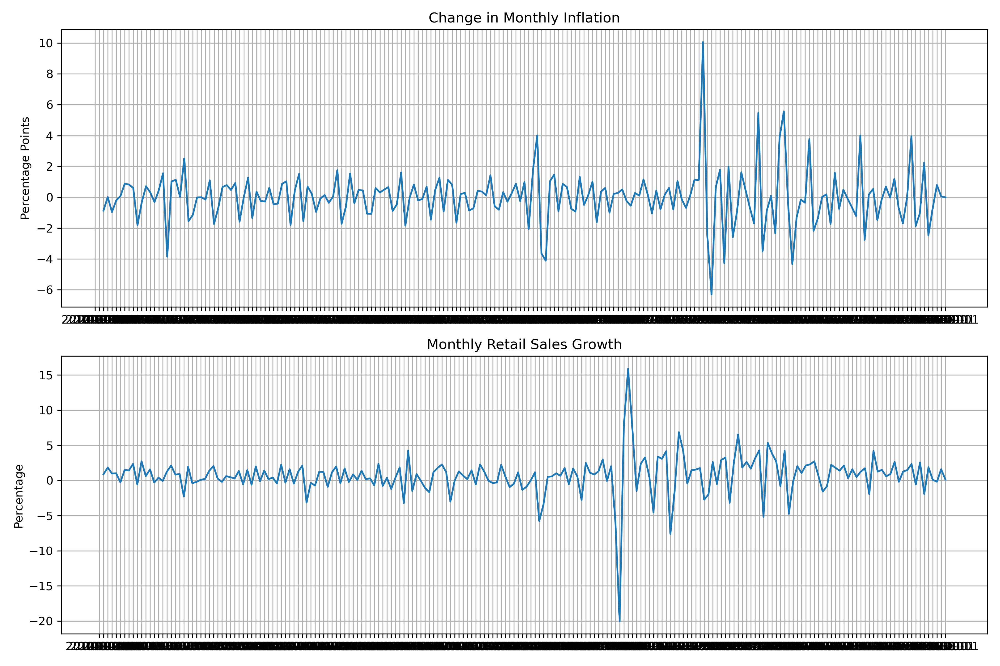

# Inflation, Consumer Demand & Business Performance – Türkiye


## Project Overview

This project examines the relationship between inflation dynamics and retail sales performance in Türkiye using monthly macroeconomic data from TurkStat.

The analysis combines exploratory data analysis, time-series econometrics, regression modeling, statistical diagnostics, and interactive Power BI visualization.

The main objective is to investigate whether changes in inflation are associated with changes in retail sales growth and whether this relationship differs between the pre- and post-March 2020 periods.

## Project Objectives

- Analyze long-term trends in consumer prices and retail sales.
- Calculate monthly inflation and retail sales growth.
- Examine the stationarity properties of the time series.
- Estimate baseline and dynamic OLS regression models.
- Apply HAC standard errors to account for heteroskedasticity and autocorrelation.
- Evaluate influential observations and model sensitivity.
- Investigate potential changes in the inflation-growth relationship after March 2020.
- Develop an interactive Power BI dashboard for business-oriented insights.

## Data Sources

The data was obtained from the Turkish Statistical Institute (TurkStat).

### 1. Consumer Price Index (CPI)

Source: [TurkStat – Data Portal](https://veriportali.tuik.gov.tr/)

The CPI dataset was filtered to retain the relevant monthly index observations.

### 2. Retail Sales Volume

Source: [TurkStat – Data Portal](https://veriportali.tuik.gov.tr/)

The retail sales dataset was filtered using the following criteria:

- Economic activity: G47 (Retail Trade)
- Change type: Monthly
- Seasonal adjustment: Seasonally adjusted

### Dataset Overview

| Property | Description |
|---|---|
| Country | Türkiye |
| Frequency | Monthly |
| Start Date | January 2010 |
| End Date | September 2026 |
| Observations | 201 |
| Variables | CPI, Retail Sales |
| Missing Values | 0 |

The final dataset contains 201 monthly observations with no missing values.

## Methodology

### 1. Data Cleaning and Preparation

The original datasets were cleaned and transformed using Python and Pandas.

The main preparation steps included:

- Filtering the relevant CPI observations.
- Selecting seasonally adjusted retail trade data.
- Converting dates into datetime format.
- Converting numerical values into appropriate data types.
- Merging both datasets using monthly dates.
- Sorting observations chronologically.

The final cleaned dataset was exported as:

`turkey_cpi_retail_cleaned.csv`

### 2. Exploratory Data Analysis (EDA)

The initial analysis examined the evolution of consumer prices and retail sales over time.

#### Descriptive Statistics

| Variable | Mean | Standard Deviation | Minimum | Maximum |
|---|---:|---:|---:|---:|
| CPI | 27.65 | 34.16 | 5.47 | 137.23 |
| Retail Sales | 99.56 | 41.14 | 52.58 | 206.19 |
| Monthly Inflation (%) | 1.64 | 1.98 | -1.44 | 13.58 |
| Monthly Retail Growth (%) | 0.73 | 2.79 | -20.01 | 15.88 |

#### Correlation Analysis

The correlation between CPI and retail sales levels was approximately 0.971.

However, this strong correlation is largely influenced by their shared upward trends and should not be interpreted as evidence of a direct economic relationship.

The correlation between monthly inflation and monthly retail sales growth was approximately -0.061, indicating a very weak contemporaneous linear relationship.

#### Visualizations

**CPI Trend**



**Retail Sales Trend**



**Monthly Inflation and Retail Sales Growth**



### 3. Time-Series Stationarity Analysis

The Augmented Dickey-Fuller (ADF) test was applied to examine the stationarity of the variables.

#### ADF Test Results

| Variable | ADF Statistic | p-value | Result |
|---|---:|---:|---|
| CPI | 0.5806 | 0.9871 | Non-Stationary |
| Retail Sales | 3.7344 | 1.0000 | Non-Stationary |
| CPI First Difference | 0.3722 | 0.9804 | Non-Stationary |
| Retail Sales First Difference | -3.0103 | 0.0339 | Stationary |
| CPI Second Difference | -5.0560 | 0.0000 | Stationary |
| Monthly Inflation | -1.9187 | 0.3233 | Non-Stationary |
| Monthly Retail Growth | -12.9882 | 0.0000 | Stationary |
| Inflation Change First Difference | -6.8923 | 0.0000 | Stationary |

The results indicate that CPI and retail sales levels are non-stationary.

Monthly retail sales growth is stationary, while the monthly inflation rate required an additional first-difference transformation.

The regression analysis therefore uses the change in monthly inflation rather than the inflation rate itself.

**Stationary Variables**



### 4. Regression Analysis

The dependent variable is monthly retail sales growth.

The main explanatory variable is the change in monthly inflation.

#### Baseline OLS Model

The baseline model is specified as:

$$
RetailGrowth_t = \beta_0 + \beta_1 InflationChange_t + \epsilon_t
$$

Results:

| Variable | Coefficient | p-value |
|---|---:|---:|
| Constant | 0.7248 | < 0.001 |
| Inflation Change | -0.0790 | 0.513 |

| Model Statistic | Value |
|---|---:|
| Observations | 199 |
| R-squared | 0.002 |
| Adjusted R-squared | -0.003 |
| F-test p-value | 0.514 |

The baseline model does not provide statistically significant evidence of a contemporaneous relationship between changes in inflation and retail sales growth.

#### Dynamic OLS Model

To account for potential delayed effects and persistence in retail sales growth, lagged variables were introduced.


$$RetailGrowth_t = \beta_0 + \beta_1 InflationChange_t + \beta_2 InflationChange_{t-1} + \beta_3 RetailGrowth_{t-1} + \epsilon_t$$


Results using HAC standard errors with 12 lags:

| Variable | Coefficient | p-value |
|---|---:|---:|
| Constant | 0.6735 | < 0.001 |
| Inflation Change | -0.1228 | 0.256 |
| Lagged Inflation Change | -0.1856 | 0.058 |
| Lagged Retail Growth | 0.0641 | 0.459 |

| Model Statistic | Value |
|---|---:|
| Observations | 198 |
| R-squared | 0.019 |
| Adjusted R-squared | 0.004 |
| HAC F-test p-value | 0.033 |

The lagged inflation coefficient is negative and approaches conventional statistical significance at the 10% level.

The overall model is statistically significant under HAC inference, although its explanatory power remains limited.

### 5. Robustness and Diagnostic Tests

#### Autocorrelation Test

The Breusch-Godfrey test indicated evidence of residual autocorrelation:

| Statistic | Value |
|---|---:|
| LM Statistic | 28.8249 |
| LM p-value | 0.0042 |
| F-statistic | 2.5842 |
| F-test p-value | 0.0034 |

HAC standard errors were therefore used for the main dynamic regression inference.

HAC standard errors adjust statistical inference for heteroskedasticity and autocorrelation but do not eliminate autocorrelation from the residuals.

#### Influential Observations

Cook's Distance was used to identify potentially influential observations.

The threshold was calculated as:

$$
D_i > \frac{4}{n}
$$

With 198 observations, the threshold was approximately 0.0202.

A total of 14 observations exceeded this threshold.

The most influential observations were concentrated around:

- April–July 2020
- February–March 2023
- August 2023

These observations were retained in the main model because they may represent genuine economic shocks rather than data errors.

#### Sensitivity Analysis

The dynamic model was re-estimated after excluding observations exceeding the Cook's Distance threshold.

| Variable | Coefficient | p-value |
|---|---:|---:|
| Constant | 0.8204 | < 0.001 |
| Inflation Change | -0.0973 | 0.302 |
| Lagged Inflation Change | -0.0479 | 0.500 |
| Lagged Retail Growth | -0.0245 | 0.806 |

The joint Wald test for the two inflation variables produced:

$$
\chi^2 = 1.2016,\quad p = 0.5484
$$

The joint significance observed in the full sample disappeared after excluding influential observations.

This suggests that the estimated relationship is sensitive to influential observations and should be interpreted cautiously.

### 6. Post-March-2020 Analysis

An additional model was estimated to investigate whether the relationship between inflation changes and retail sales growth differed after March 2020.

A post-March-2020 dummy variable and interaction terms were introduced.

$$
\begin{aligned}
\text{RetailGrowth}_t =\;& \beta_0
+ \beta_1 \text{InflationChange}_t \\
&+ \beta_2 \text{InflationChange}_{t-1}
+ \beta_3 \text{RetailGrowth}_{t-1} \\
&+ \beta_4 \text{Post2020}_t
+ \beta_5 (\text{InflationChange}_t \times \text{Post2020}_t) \\
&+ \beta_6 (\text{InflationChange}_{t-1} \times \text{Post2020}_t)
+ \epsilon_t
\end{aligned}
$$

#### HAC Regression Results

| Variable | Coefficient | p-value |
|---|---:|---:|
| Constant | 0.4180 | 0.001 |
| Inflation Change | -0.2265 | 0.081 |
| Lagged Inflation Change | -0.1832 | 0.204 |
| Lagged Retail Growth | 0.0511 | 0.588 |
| Post-2020 Dummy | 0.6629 | 0.017 |
| Inflation Interaction | 0.1476 | 0.422 |
| Lagged Inflation Interaction | -0.0074 | 0.969 |

#### Joint Interaction Wald Test

The joint Wald test examined whether the two interaction coefficients were jointly equal to zero.

$$
H_0: \beta_5 = \beta_6 = 0
$$

Results:

| Statistic | Value |
|---|---:|
| Chi-square | 0.6534 |
| p-value | 0.7213 |
| Degrees of Freedom | 2 |

The interaction terms are not jointly statistically significant.

Therefore, the analysis does not provide sufficient evidence that the relationship between inflation changes and retail sales growth changed after March 2020.

The post-2020 dummy covers the entire period from March 2020 to September 2026. It should be interpreted as a post-March-2020 regime indicator rather than an isolated COVID-19 effect.

#### Chow Structural Break Test

A Chow test was also conducted to examine a potential structural break in March 2020.

| Statistic | Value |
|---|---:|
| Pre-2020 Observations | 119 |
| Post-2020 Observations | 79 |
| Chow F-statistic | 0.3076 |
| p-value | 0.8726 |

The test does not provide evidence of a structural break at March 2020.

### 7. Power BI Dashboard

An interactive Power BI dashboard was developed to present the main economic indicators and their evolution over time.

**Dashboard Title: Inflation & Retail Business Performance**

The dashboard includes:

- CPI trend over time
- Retail sales volume trend
- Monthly inflation and retail sales growth
- Key performance indicator cards

#### Key Performance Indicators

| KPI | Value |
|---|---:|
| Average CPI | 27.65 |
| Average Retail Sales | 99.56 |
| Latest Monthly Inflation | 1.84% |
| Latest Monthly Retail Growth | 0.14% |

The dashboard provides a business-oriented overview of inflation dynamics and retail performance in Türkiye.

### 8. Key Economic and Business Insights

The analysis provides several observations:

1. Consumer prices and retail sales both experienced substantial long-term increases during the sample period.
2. Their high level correlation does not imply a direct relationship, as both series exhibit strong trends.
3. Monthly inflation changes show a weak contemporaneous association with retail sales growth.
4. The dynamic model suggests a negative lagged inflation coefficient, although its statistical significance is sensitive to the estimation sample.
5. Influential observations, particularly around 2020 and 2023, have a substantial impact on the estimated relationship.
6. Neither the interaction analysis nor the Chow test provides sufficient evidence of a structural change in March 2020.

Overall, the findings suggest that the relationship between inflation dynamics and retail sales performance is not straightforward and requires careful consideration of time-series properties, model specification, and influential economic events.

## Project Structure

```text
Inflation-Retail-Analysis/
│
├── data/
│   └── turkey_cpi_retail_cleaned.csv
│
├── notebooks/
│   └── inflation_retail_analysis.ipynb
│
├── powerbi/
│   └── inflation_retail_business_dashboard.pbix
│
├── visuals/
│   ├── cpi_trend.png
│   ├── retail_sales_trend.png
│   ├── monthly_changes.png
│   └── stationary_variables.png
│
└── README.md
